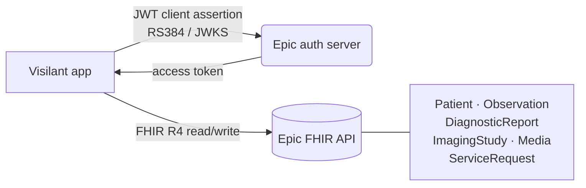
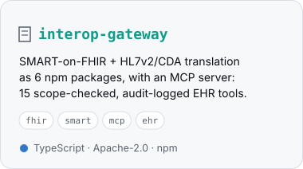
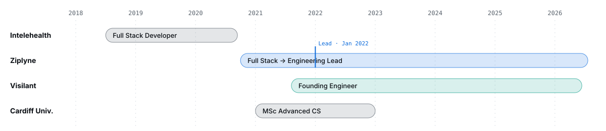

<picture>
  <source media="(prefers-color-scheme: dark)" srcset="assets/header-dark.svg">
  
</picture>

  
  
  
  

 

<picture>
  <source media="(prefers-color-scheme: dark)" srcset="assets/section-about-dark.svg">
  
</picture>

I'm a full-stack engineer with 8+ years of building products end to end: React and Angular front ends, Node.js and TypeScript back ends, AWS infrastructure, and the integrations that tie it all together. I've been the first engineer on a product and the tech lead of a 16-person team, often both at once.

Along the way I've worked across very different problems:

- **Enterprise SaaS:** a Chrome-extension platform serving **150K+ users**, 30K of them at **Johns Hopkins**, across ServiceNow, SAP, Workday and more
- **Identity and data:** SAML/OAuth2 SSO for enterprise customers and an HR data sync that scaled to **120K records**
- **Healthcare:** a product taken from zero to **5 live hospitals in 2 years**, with an Epic integration and an ML screening pipeline that has seen **50,000+ patients**
- **Compliance:** owned the engineering side of **HIPAA** and **SOC 2** audits
- **AI tooling:** MCP servers, on-device speech-to-text, and local-first apps on the side

I'm based in Hyderabad and work US hours. I'm open to Lead, Staff and senior full-stack roles, in any domain where the problems are interesting.

<picture>
  <source media="(prefers-color-scheme: dark)" srcset="assets/impact-dark.svg">
  
</picture>

  

<picture>
  <source media="(prefers-color-scheme: dark)" srcset="assets/section-work-dark.svg">
  
</picture>

### 🧭 URL+: an enterprise Chrome-extension platform for 150K users · *Ziplyne*

**Problem.** Ziplyne's in-app guides run as a browser extension (Manifest V2/V3) on top of other companies' enterprise apps. They have to know exactly which screen a user is on, even though those apps' URLs change all the time. 
**What I built.** Per-platform adapters that resolve those URLs to one canonical page, and a selector engine that finds targets through iframes and shadow DOM. It covers ServiceNow, SAP (Fiori, Portal, ESS), SuccessFactors, Microsoft Dynamics, Coupa and Workday. 
**Outcome.** Serves **150K+ users**, including 30K at Johns Hopkins.

### 🔐 Enterprise identity and HR sync · *Ziplyne*

- **Workday HR sync:** RaaS report ingestion, user upsert and group reconciliation as a BullMQ job. Grew from **50K to 120K** records.
- **SSO for 5 enterprise customers:** SAML (Okta, IBM Security Verify, Shibboleth) and Coupa OAuth2, with automatic user and role setup on first login.
- **SOC 2:** owned the AWS database controls, covering encryption at rest and in transit, and backups.

### 🏥 A healthcare product from zero to 5 hospitals · *Visilant*

**Context.** I was the only full-stack engineer, owning the React front end and the Node.js back end. Hospital customers needed results to land in the patient's Epic chart, with no re-typing and no CSV exports. 
**What I built.** The product itself, plus a SMART-on-FHIR backend client that reads and writes Patient, Observation, DiagnosticReport, ImagingStudy, Media and ServiceRequest. It authenticates by JWT client assertion against an RS384-signed JWKS. I also built multi-tenant isolation: tenant-scoped request context, JWT tenant checks and tenant-scoped caching. 
**Outcome.** Live in 5 hospitals within 2 years. HIPAA audit passed, with audit-trail tables and ABHA health-ID handling.

### 👁️ Seeker: ML-assisted eye screening · *Visilant*

**What I built.** APIs that send captured eye images to a production ML diagnosis model, and the clinician view that shows the suggested diagnosis next to the patient record. 
**Outcome.** **50,000+ patients** screened in production with partners including Aravind Eye Hospital and Dr. Shroff's Charity Eye Hospital.

 

<picture>
  <source media="(prefers-color-scheme: dark)" srcset="assets/section-oss-dark.svg">
  
</picture>

Three TypeScript libraries published on npm that turn legacy healthcare formats (HL7v2, C-CDA) into FHIR without dropping fields, plus a couple of local-first tools I built for myself.

  <a href="https://github.com/heyitskundan/interop-gateway"><picture><source media="(prefers-color-scheme: dark)" srcset="assets/oss-interop-gateway-dark.svg"></picture></a>
  <a href="https://github.com/heyitskundan/hl7-fhir-translator"><picture><source media="(prefers-color-scheme: dark)" srcset="assets/oss-hl7-fhir-translator-dark.svg"></picture></a>
  <a href="https://github.com/heyitskundan/cda-fhir-translator"><picture><source media="(prefers-color-scheme: dark)" srcset="assets/oss-cda-fhir-translator-dark.svg"></picture></a>

> **MCP server:** `interop-gateway` ships an **MCP server** that lets an AI agent use a live system through 15 tools, with every call scope-checked and audit-logged first.

**Side projects (Python):**
- [whispr](https://github.com/heyitskundan/whispr): on-device push-to-talk speech-to-text. Hold a key, speak, and the text is pasted into whatever app you're in.
- [daylog](https://github.com/heyitskundan/daylog): a local-first activity tracker that turns your day into a timeline of tasks and screenshots, using on-device OCR and SQLite.

 

<picture>
  <source media="(prefers-color-scheme: dark)" srcset="assets/section-journey-dark.svg">
  
</picture>

<picture>
  <source media="(prefers-color-scheme: dark)" srcset="assets/timeline-dark.svg">
  
</picture>

<b>Visilant</b> · Founding Engineer · Aug 2021 to Jun 2026 · remote

 

- Only full-stack engineer on a team of 5; owned the backend and the React front end
- Took the product from scratch to 5 hospital deployments in 2 years
- Built the Epic SMART-on-FHIR integration, the Seeker ML screening pipeline, the multi-tenant migration and the HIPAA technical controls

<b>Ziplyne</b> · Software Engineering Lead · Oct 2020 to Jul 2026 · remote

 

- Joined as a full-stack engineer and was promoted to lead in Jan 2022
- Technical lead of 16 people: 5 engineers, 4 QA, 3 designers, 2 customer success and 1 PM
- Built URL+, the Workday HR sync and SSO for 5 enterprise customers, and owned the SOC 2 database controls

<b>Intelehealth</b> · Full Stack Developer · Jul 2018 to Sep 2020 · Thane

 

- Built the Angular front end of the [doctor web app](https://github.com/Intelehealth/intelehealth-doctor-webapp) (16★, 29 forks) for a telehealth platform on OpenMRS
- Built the Node.js image upload and retrieval API

<b>Cardiff University</b> · MSc Advanced Computer Science · 2021 to 2023

 

- Thesis: *Creating a User Interface for Virtual Assistants*, a COVID-advisory chatbot on IBM Watson Assistant and Cloudant

 

<picture>
  <source media="(prefers-color-scheme: dark)" srcset="assets/section-stack-dark.svg">
  
</picture>

| Area | Tools |
|---|---|
| **Languages** |     |
| **Front end** |   -0B0F14?style=flat-square&logo=googlechrome&logoColor=2DD4BF)   |
| **Back end** |     |
| **Data & infra** |      |
| **Identity & security** |       |
| **Integrations** |        |
| **AI** |     |

 

---

  Need someone who can own a product from the first commit to production? <a href="mailto:heyitskundan.dev@gmail.com"><b>Let's talk.</b></a>

