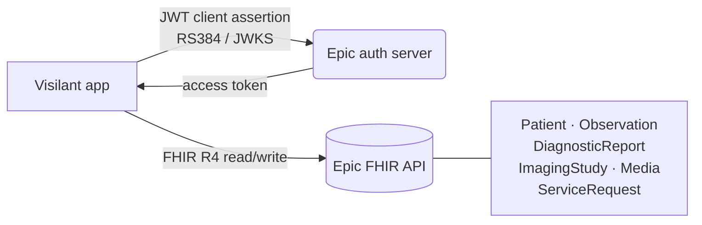
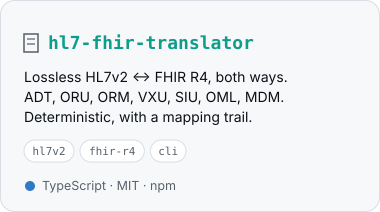
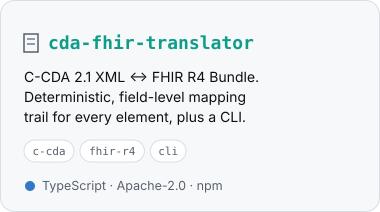

<picture>
  <source media="(prefers-color-scheme: dark)" srcset="assets/header-dark.svg">
  
</picture>

  
  
  
  

 

<picture>
  <source media="(prefers-color-scheme: dark)" srcset="assets/section-about-dark.svg">
  
</picture>

I build the plumbing between clinical systems and the products that need their data: FHIR R4, HL7v2, C-CDA, SMART-on-FHIR and Epic, with HIPAA in mind from the first commit.

As **founding engineer at Visilant**, I took a healthcare product from nothing to **5 live hospital deployments in 2 years**, wired it into **Epic over SMART-on-FHIR**, and carried it through a **HIPAA audit**. Its eye-screening pipeline has reached **50,000+ patients**. At the same time I was **engineering lead at Ziplyne**, running a **16-person team** that shipped an enterprise platform to **150K+ users**, 30K of them at **Johns Hopkins**, through **SOC 2**.

I'm based in Hyderabad and work US hours. I'm looking for Lead or Staff roles at healthtech, EHR and interoperability companies.

<picture>
  <source media="(prefers-color-scheme: dark)" srcset="assets/impact-dark.svg">
  
</picture>

  

<picture>
  <source media="(prefers-color-scheme: dark)" srcset="assets/section-work-dark.svg">
  
</picture>

### 🏥 Epic integration across 5 hospitals · *Visilant*

**Problem.** Hospital customers needed screening results to land in the patient's Epic chart, with no re-typing and no CSV exports. 
**What I built.** A SMART-on-FHIR backend client that reads and writes Patient, Observation, DiagnosticReport, ImagingStudy, Media and ServiceRequest. It authenticates by JWT client assertion against an RS384-signed JWKS. I also built multi-tenant isolation: tenant-scoped request context, JWT tenant checks and tenant-scoped caching. 
**Outcome.** Live in 5 hospitals within 2 years. HIPAA audit passed, with audit-trail tables and ABHA health-ID handling.

### 👁️ Seeker: ML-assisted eye screening · *Visilant*

**What I built.** APIs that send captured eye images to a production ML diagnosis model, and the clinician view that shows the suggested diagnosis next to the patient record. 
**Outcome.** **50,000+ patients** screened in production with partners including Aravind Eye Hospital and Dr. Shroff's Charity Eye Hospital.

### 🧭 URL+: page identification for 150K users · *Ziplyne*

**Problem.** In-app guides have to know exactly which screen a user is on, across enterprise apps whose URLs change all the time. 
**What I built.** Per-platform adapters that resolve those URLs to one canonical page, and a selector engine that finds targets through iframes and shadow DOM. It covers ServiceNow, SAP (Fiori, Portal, ESS), SuccessFactors, Microsoft Dynamics, Coupa and Workday. 
**Outcome.** Serves **150K+ users**, including 30K at Johns Hopkins.

### 🔐 Enterprise identity and HR sync · *Ziplyne*

- **Workday HR sync:** RaaS report ingestion, user upsert and group reconciliation as a BullMQ job. Grew from **50K to 120K** records.
- **SSO for 5 enterprise customers:** SAML (Okta, IBM Security Verify, Shibboleth) and Coupa OAuth2, with automatic user and role setup on first login.
- **SOC 2:** owned the AWS database controls, covering encryption at rest and in transit, and backups.

 

<picture>
  <source media="(prefers-color-scheme: dark)" srcset="assets/section-oss-dark.svg">
  
</picture>

Most healthcare data still moves as HL7v2 pipes and C-CDA XML. I write the libraries that turn it into FHIR without dropping fields, and that let you trace every output field back to its source.

  <a href="https://github.com/heyitskundan/interop-gateway"><picture><source media="(prefers-color-scheme: dark)" srcset="assets/oss-interop-gateway-dark.svg"></picture></a>
  <a href="https://github.com/heyitskundan/hl7-fhir-translator"><picture><source media="(prefers-color-scheme: dark)" srcset="assets/oss-hl7-fhir-translator-dark.svg"></picture></a>
  <a href="https://github.com/heyitskundan/cda-fhir-translator"><picture><source media="(prefers-color-scheme: dark)" srcset="assets/oss-cda-fhir-translator-dark.svg"></picture></a>

> **For AI-in-healthcare teams:** `interop-gateway` ships an **MCP server**, so an AI agent can query a live EHR through 15 tools. Every call is scope-checked and audit-logged before it touches the system.

**Side projects:** [whispr](https://github.com/heyitskundan/whispr) (on-device push-to-talk speech-to-text) · [daylog](https://github.com/heyitskundan/daylog) (local-first activity tracker with on-device OCR)

 

<picture>
  <source media="(prefers-color-scheme: dark)" srcset="assets/section-journey-dark.svg">
  
</picture>

<picture>
  <source media="(prefers-color-scheme: dark)" srcset="assets/timeline-dark.svg">
  
</picture>

<b>Visilant</b> · Founding Engineer · Aug 2021 to Jun 2026 · remote

 

- Only full-stack engineer on a team of 5; owned the backend and the React front end
- Took the product from scratch to 5 hospital deployments in 2 years
- Built the Epic SMART-on-FHIR integration, the Seeker ML screening pipeline, the multi-tenant migration and the HIPAA technical controls

<b>Ziplyne</b> · Software Engineering Lead · Oct 2020 to Jul 2026 · remote

 

- Joined as a full-stack engineer and was promoted to lead in Jan 2022
- Technical lead of 16 people: 5 engineers, 4 QA, 3 designers, 2 customer success and 1 PM
- Built URL+, the Workday HR sync and SSO for 5 enterprise customers, and owned the SOC 2 database controls

<b>Intelehealth</b> · Full Stack Developer · Jul 2018 to Sep 2020 · Thane

 

- Built the Angular front end of the [doctor web app](https://github.com/Intelehealth/intelehealth-doctor-webapp) (16★, 29 forks) for a telehealth platform on OpenMRS
- Built the Node.js image upload and retrieval API

<b>Cardiff University</b> · MSc Advanced Computer Science · 2021 to 2023

 

- Thesis: *Creating a User Interface for Virtual Assistants*, a COVID-advisory chatbot on IBM Watson Assistant and Cloudant

 

<picture>
  <source media="(prefers-color-scheme: dark)" srcset="assets/section-stack-dark.svg">
  
</picture>

| Area | Tools |
|---|---|
| **Interoperability** |        |
| **Compliance** |   |
| **Languages & frameworks** |      |
| **Infrastructure** |      |
| **Identity** |     |
| **AI tooling** |   |

 

---

  Building on FHIR and need someone who has shipped it into real hospitals? <a href="mailto:heyitskundan.dev@gmail.com"><b>Let's talk.</b></a>

