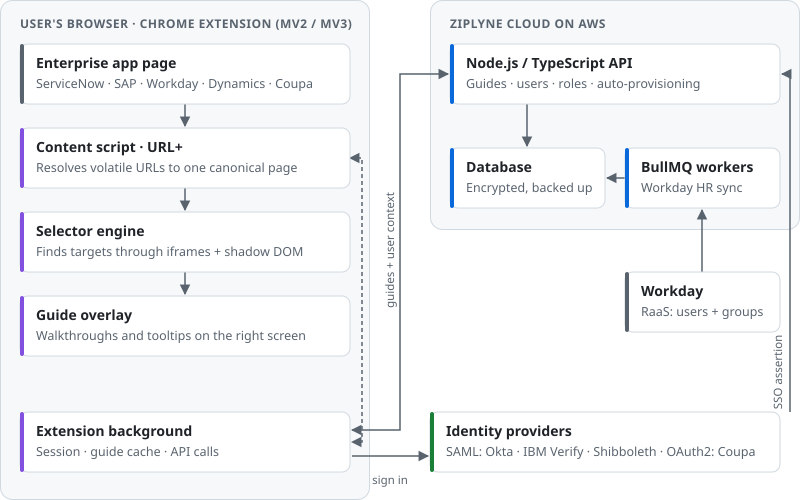
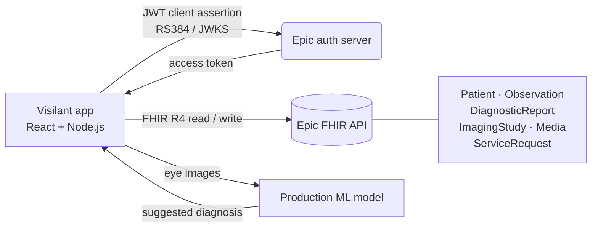

<picture>
  <source media="(prefers-color-scheme: dark)" srcset="assets/header-dark.svg">
  
</picture>

  
  
  

## About

I'm a full-stack engineer with 8+ years of building products end to end: React and Angular front ends, Node.js and TypeScript back ends, AWS infrastructure, and the integrations that tie it all together. I've been the first engineer on a product and the tech lead of a 16-person team, often both at once.

- **Enterprise SaaS:** a Chrome-extension platform serving **150K+ users**, 30K of them at **Johns Hopkins**, across ServiceNow, SAP, Workday and more
- **Identity and data:** SAML/OAuth2 SSO for 5 enterprise customers, and an HR data sync that scaled to **120K records**
- **Healthcare:** a product taken from zero to **5 live hospitals in 2 years**, with an Epic integration and an ML screening pipeline that has seen **50,000+ patients**
- **Compliance:** owned the engineering side of **HIPAA** and **SOC 2** audits
- **AI tooling:** MCP servers, on-device speech-to-text and local-first apps

I'm open to Lead, Staff and senior full-stack roles, in any domain where the problems are interesting.

<picture>
  <source media="(prefers-color-scheme: dark)" srcset="assets/impact-dark.svg">
  
</picture>

## Selected work

### Ziplyne: in-app guidance for enterprise apps, as a browser extension

Ziplyne puts step-by-step guides on top of other companies' enterprise apps. The hard part is knowing exactly which screen a user is on, when apps like SAP and ServiceNow change their URLs all the time and bury content in iframes and shadow DOM. I led the team that built it and wrote the core engines.

<picture>
  <source media="(prefers-color-scheme: dark)" srcset="assets/ziplyne-architecture-dark.svg">
  
</picture>

- **URL+ page identification:** per-platform adapters resolve volatile URLs to one canonical page, so the right guide shows on the right screen for **150K+ users** (30K+ at Johns Hopkins)
- **Selector engine:** finds guide targets inside iframes and shadow DOM across six enterprise platforms
- **Workday HR sync:** RaaS report ingestion, user upsert by email and group reconciliation as a BullMQ background job, from **50K to 120K** records
- **SSO for 5 enterprise customers:** SAML (Okta, IBM Security Verify, Shibboleth) and Coupa OAuth2, with automatic user and role setup on first login
- **SOC 2:** owned the AWS database controls, covering encryption at rest and in transit, and backups
- **Team:** tech lead of 16 people (5 engineers, 4 QA, 3 designers, 2 customer success, 1 PM)

Simplified view of the architecture.

### Visilant: a healthcare product from zero to 5 hospitals

I was the only full-stack engineer on a team of 5, owning the React front end and the Node.js back end. Hospital customers needed results to land straight in the patient's Epic chart.

- **Epic integration:** a SMART-on-FHIR backend client covering six FHIR resources, live in **5 hospitals within 2 years**
- **Seeker screening pipeline:** sends captured eye images to a production ML model and shows the suggested diagnosis to clinicians. **50,000+ patients** screened with partners including Aravind Eye Hospital and Dr. Shroff's Charity Eye Hospital
- **Multi-tenant migration:** tenant-scoped request context, JWT tenant checks and tenant-scoped caching
- **HIPAA audit passed:** owned the technical controls, audit-trail tables and ABHA health-ID handling

## Open source and side projects

- **[interop-gateway](https://github.com/heyitskundan/interop-gateway)**, **[hl7-fhir-translator](https://github.com/heyitskundan/hl7-fhir-translator)** and **[cda-fhir-translator](https://github.com/heyitskundan/cda-fhir-translator)**: TypeScript libraries on npm that convert HL7v2 and C-CDA to FHIR R4 and back without losing fields
- **[whispr](https://github.com/heyitskundan/whispr)**: on-device push-to-talk speech-to-text in Python
- **[daylog](https://github.com/heyitskundan/daylog)**: a local-first activity tracker with on-device OCR

All of them are pinned below.

`interop-gateway` also ships an **MCP server**, so an AI agent can work with a live system through 15 tools, with every call scope-checked and audit-logged first.

## Experience

<picture>
  <source media="(prefers-color-scheme: dark)" srcset="assets/timeline-dark.svg">
  
</picture>

<b>Ziplyne</b> · Software Engineering Lead · Oct 2020 to Jul 2026 · remote

 

- Joined as a full-stack engineer and was promoted to lead in Jan 2022
- Tech lead of 16 people; owned technical direction and architecture
- Built URL+, the selector engine, the Workday HR sync and SSO for 5 enterprise customers; owned the SOC 2 database controls

<b>Visilant</b> · Founding Engineer · Aug 2021 to Jun 2026 · remote

 

- Only full-stack engineer on a team of 5; owned the backend and the React front end
- Took the product from scratch to 5 hospital deployments in 2 years
- Built the Epic integration, the Seeker ML pipeline, the multi-tenant migration and the HIPAA technical controls

<b>Intelehealth</b> · Full Stack Developer · Jul 2018 to Sep 2020 · Thane

 

- Built the Angular front end of a telehealth doctor web app on OpenMRS, from scratch
- Built the Node.js image upload and retrieval API

<b>Cardiff University</b> · MSc Advanced Computer Science · 2021 to 2023

 

- Thesis: *Creating a User Interface for Virtual Assistants*, a COVID-advisory chatbot on IBM Watson Assistant and Cloudant

## Tech stack

**Languages** 
&nbsp;
&nbsp;
&nbsp;
&nbsp;

**Front end** 
&nbsp;
&nbsp;
&nbsp;

**Back end and data** 
&nbsp;
<picture><source media="(prefers-color-scheme: dark)" srcset="https://cdn.jsdelivr.net/gh/devicons/devicon@latest/icons/amazonwebservices/amazonwebservices-plain.svg"></picture>&nbsp;
&nbsp;
&nbsp;
&nbsp;

**Identity, enterprise and AI** 
&nbsp;
&nbsp;
&nbsp;
&nbsp;

**Also:** SAML SSO · OAuth2 · JWT/JWKS · BullMQ · Workday · ServiceNow · Coupa · Microsoft Dynamics · FHIR R4 · HL7v2 · C-CDA · SMART-on-FHIR · Epic · OpenMRS · SOC 2 · HIPAA

---

Need someone who can own a product from the first commit to production? <a href="mailto:heyitskundan.dev@gmail.com"><b>Let's talk.</b></a>

